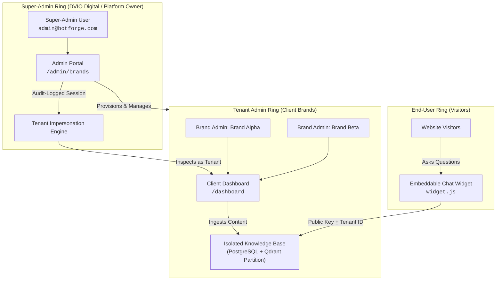
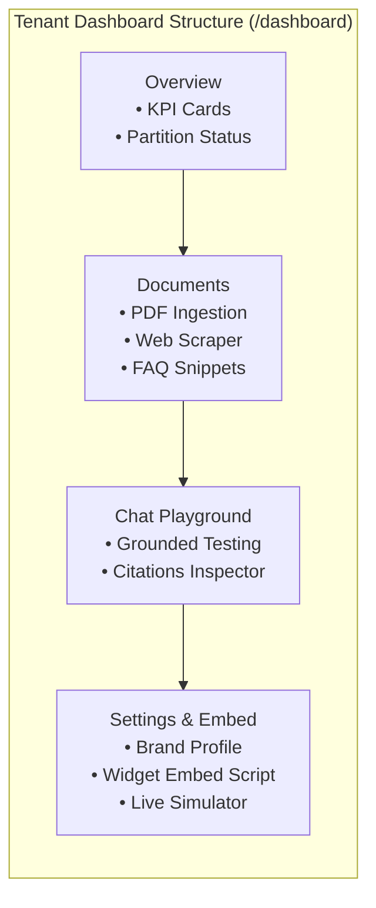
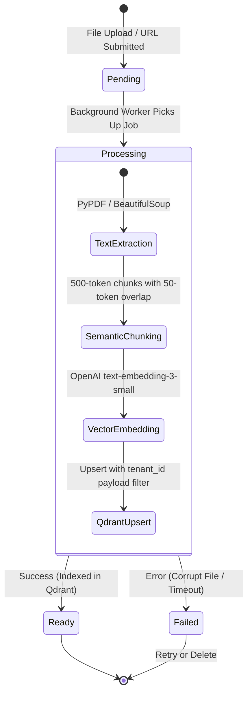

# 16 — Super-Admin and Tenant Admin User Guide

> **Document Purpose:** Comprehensive operational handbook and functional guide for both **Super-Administrators** (Product Admins / Platform Operators) and **Tenant Administrators** (Client Brand Owners).  
> **Target Audience:** Platform Owners, Customer Support Engineers, Account Managers, Client Brand Administrators, and System Integrators.

---

## 1. System Roles & Access Control Model

BotForge operates on a strict **Hierarchical Multi-Tenant Architecture**. Users interact with the platform under two distinct privilege rings:



### Roles and Capabilities Matrix

| Feature / Action | Super-Admin | Tenant Admin | End-User (Visitor) |
| :--- | :---: | :---: | :---: |
| **Authenticate via `/login`** | Yes (Superadmin credentials) | Yes (Brand owner credentials) | No (Unauthenticated) |
| **View Fleet Health & All Brands** | Yes (`/admin/brands`) | No (Forbidden - 403) | No (Forbidden) |
| **Provision / Onboard New Brands** | Yes | No | No |
| **Impersonate Brand Dashboard** | Yes (With audit logging) | No | No |
| **Toggle Brand Status (Active/Suspended)** | Yes | No | No |
| **Purge / Delete Brand Workspace** | Yes (Cascades all data) | No | No |
| **Upload PDFs, URLs, and FAQs** | Yes (via Impersonation) | Yes (`/dashboard/documents`) | No |
| **Inspect Vector Chunks & Index Status**| Yes (via Impersonation) | Yes (`/dashboard/documents/[id]`) | No |
| **Test RAG in Chat Playground** | Yes (via Impersonation) | Yes (`/dashboard/chat-playground`)| No |
| **Retrieve Embed Snippet & API Key** | Yes | Yes (`/dashboard/settings`) | No |
| **Chat with Live Bot on External Site** | Yes | Yes | Yes (Restricted to Brand KB) |

---

## 2. Super-Admin Operations Manual (`/admin/brands`)

The **Super-Admin Portal** allows platform operators to oversee all client brands, provision workspaces, inspect resource utilization, and perform troubleshooting.

### 2.1 Authentication & Protected Entry

1. Navigate to `https://<YOUR_DOMAIN>/login`.
2. Enter the platform operator email (configured via `SUPERADMIN_EMAIL`, default: `admin@botforge.com`) and master password.
3. Upon validation, the backend issues an HttpOnly, Lax, Secure cookie named `botforge_admin_token`.
4. The system automatically redirects the Super-Admin to `/admin/brands`.

---

### 2.2 Global Fleet Overview & Metrics

At the top of the **Client Brands Management** console (`/admin/brands`), four high-level telemetry cards summarize workspace status:

```
┌──────────────────┐  ┌──────────────────┐  ┌──────────────────┐  ┌──────────────────┐
│   TOTAL BRANDS   │  │  ACTIVE BRANDS   │  │    SUSPENDED     │  │ ENTERPRISE TIER  │
│        12        │  │        10        │  │        2         │  │        4         │
└──────────────────┘  └──────────────────┘  └──────────────────┘  └──────────────────┘
```

- **Total Brands:** Count of all multi-tenant workspaces created in PostgreSQL.
- **Active Brands:** Workspaces permitted to accept knowledge uploads and respond to widget requests.
- **Suspended:** Workspaces paused due to billing, onboarding, or administrative review.
- **Enterprise Tier:** Client accounts with dedicated rate quotas and custom SLA parameters.

---

### 2.3 Brand Directory: Search, Filter, and Pagination

The Brand Table provides fleet-wide observability:
- **Search Bar:** Real-time client-side and server-side filtering by **Brand Name**, **Slug**, or **Owner Email**.
- **Status Filter Tabs:** Switch between `All Brands`, `Active`, and `Suspended`.
- **Table Attributes:**
  - **Brand / Client:** Brand name and unique sub-domain slug (e.g., `acme-corp`).
  - **Owner Email:** Primary contact holding root ownership for the brand.
  - **Plan:** Badge indicator (`starter` [gray], `pro` [blue], `enterprise` [purple]).
  - **Status:** Real-time active indicator dot (`Active` [green], `Suspended` [red]).
  - **Created Date:** Timestamp of initial provisioning.

---

### 2.4 Provisioning a New Client Brand (Onboarding)

Super-Admins can onboard a new brand either via the quick **Onboard Brand Modal** or the **Full Form** (`/admin/brands/new`).

```mermaid
sequenceDiagram
    autonumber
    actor Admin as Super-Admin
    participant UI as Admin Dashboard (/admin/brands)
    participant API as FastAPI Backend (/api/v1/admin/brands)
    participant DB as PostgreSQL
    participant QD as Qdrant Vector DB

    Admin->>UI: Click "+ Onboard Brand"
    UI->>Admin: Displays Onboarding Modal
    Admin->>UI: Submits Name, Slug, Email, Password, Plan
    UI->>API: POST /api/v1/admin/brands
    
    rect rgb(30, 26, 23)
        Note over API,DB: Atomic Transaction
        API->>DB: INSERT INTO tenants (name, slug, plan, is_active)
        API->>DB: INSERT INTO users (email, hashed_pw, role='tenant_admin')
        API->>DB: INSERT INTO api_keys (tenant_id, public_key)
        API->>QD: Initialize Tenant Vector Partition (Payload Filter)
    end

    API-->>UI: 201 Created (Tenant ID & Metadata)
    UI-->>Admin: Show Success Toast & Refresh Fleet Table
```



#### Provisioning Fields Reference:
1. **Brand / Organization Name:** e.g., `Acme Healthcare Inc.`
2. **Workspace Slug:** URL-safe identifier (e.g., `acme-healthcare`). Must be globally unique.
3. **Primary Owner Email:** The login email address for the client brand administrator.
4. **Temporary Password:** Minimum 8 characters (requires uppercase, lowercase, number, special character).
5. **Subscription Tier:**
   - `starter`: Standard rate limits (60 RPM widget, 15 RPM auth), max 20 documents.
   - `pro`: Elevated limits (120 RPM widget), max 100 documents.
   - `enterprise`: Custom throughput, priority vector search.

---

### 2.5 Impersonation Engine ("Dashboard" Access)

When a client reports an issue with document ingestion or bot response accuracy, Super-Admins can enter their workspace without asking for credentials.

1. Locate the brand in the table and click **Dashboard** (`[↗ Dashboard]`).
2. The platform executes `POST /api/v1/admin/brands/{tenant_id}/impersonate`.
3. The backend generates an isolated JWT stamped with the client's `tenant_id` and sets an HttpOnly cookie: `botforge_impersonation_token`.
4. The Super-Admin is redirected to `/dashboard`.
5. An **Amber Impersonation Banner** appears across the top of the interface:
   ```
   [👁️ IMPERSONATION MODE] Viewing as: Acme Healthcare (Tenant ID: 9f8e-...)  [Exit Impersonation]
   ```
6. Clicking **Exit Impersonation** immediately calls `POST /api/v1/admin/brands/exit-impersonation`, clears the impersonation cookie, and restores Super-Admin context back at `/admin/brands`.

---

### 2.6 Brand Inspection, Suspension, and Deletion

- **Inspect (`/admin/brands/[tenantId]`):** View raw tenant configuration, created timestamps, total indexed document counts, and public API keys.
- **Suspend / Reactivate:**
  - Clicking the toggle calls `PATCH /api/v1/admin/brands/{tenant_id}/status`.
  - When suspended, all brand users are locked out immediately, and public widget queries for that `tenant_id` return `403 Tenant Suspended`.
- **Purge / Delete Brand:**
  - Clicking the **Trash Icon** opens a destructive confirmation modal.
  - Requires typing the brand name to verify intent.
  - **Cascade Effect:** Permanently deletes PostgreSQL tenant records, users, documents, chunks, and purges all vector points from Qdrant matching `tenant_id`.

---

## 3. Tenant Admin Operations Manual (`/dashboard`)

The **Client Dashboard** is the command center where brand owners manage their knowledge base, configure bot behavior, test responses, and retrieve embed scripts.



---

### 3.1 Dashboard Overview (`/dashboard`)

Upon logging in, Tenant Admins are greeted by the **Dark Glassmorphic Overview**:
- **Welcome Banner:** Confirms organizational identity and displays the active **Tenant UUID** with a 1-click copy button.
- **Vector Partition Status:** Displays a green pulse indicator confirming dedicated Qdrant vector isolation.
- **Fleet KPI Metrics:**
  - **Total Documents:** Total files and URLs uploaded.
  - **Ready Documents:** Content successfully parsed, embedded, and searchable.
  - **Processing Queue:** Documents currently in background chunking or vectorization.
  - **Indexed Chunks:** Total text fragments stored in Qdrant for semantic search.
- **Quick Action Hub:** One-click shortcuts to **Ingest Knowledge**, **Chat Playground**, and **Widget Settings**.
- **Recent Ingestion Feed:** Chronological table of recently processed documents with live status indicators.

---

### 3.2 Knowledge Base & Document Management (`/dashboard/documents`)

BotForge chatbots answer questions **strictly using your uploaded content**. The Knowledge Base interface manages this repository.



#### Ingestion Channels Supported:

#### 1. PDF Document Upload
- **How to use:** Click **Add Content** ➔ Select the **PDF Document** tab ➔ Drag and drop or browse for a `.pdf` file (max 20 MB).
- **Processing Details:** Text is extracted page-by-page, cleaned of hyphenation breaks, split into semantic windows, embedded using `text-embedding-3-small`, and stored with page-number metadata.

#### 2. Web Page URL Scraper
- **How to use:** Click **Add Content** ➔ Select the **Web Page URL** tab ➔ Enter a full URL (e.g., `https://example.com/pricing`).
- **Processing Details:** BotForge fetches the page, removes navigation bars, footers, scripts, and CSS, isolating main editorial text for chunking.

#### 3. FAQ Snippet (Structured Q&A)
- **How to use:** Click **Add Content** ➔ Select the **FAQ Snippet** tab ➔ Provide a Title, Question, and Canonical Answer.
- **Processing Details:** Stored as high-priority semantic pairs. Ideal for return policies, working hours, pricing tiers, and contact numbers.

#### Document Actions:
- **Inspect Chunks (`/dashboard/documents/[documentId]`):** Click on any document to inspect all generated chunks, character lengths, and vector payload IDs.
- **Delete Document:** Removes the document from PostgreSQL and immediately purges all associated vector points from Qdrant.

---

### 3.3 Interactive Chat Playground (`/dashboard/chat-playground`)

The **Chat Playground** lets brand owners simulate conversations exactly as their customers will experience them.

```
┌────────────────────────────────────────────────────────────────────────┐
│ BotForge Chat Playground                       [Ready: 12 docs / 184 chunks] │
├────────────────────────────────────────────────────────────────────────┤
│ 🤖 Assistant: Welcome! Ask me anything about Acme Healthcare.          │
│                                                                        │
│ 👤 User: What is the refund policy for annual checkups?                │
│                                                                        │
│ 🤖 Assistant: According to our Policy Guide, refunds must be requested │
│    within 14 days of appointment scheduling. No refunds after service. │
│                                                                        │
│    ┌─ Source Citations ───────────────────────────────────────────┐    │
│    │ 📄 refund_policy_2026.pdf (Chunk #3, Similarity: 0.89)       │    │
│    │ "Refund requests received within 14 calendar days of booking..."   │    │
│    └──────────────────────────────────────────────────────────────┘    │
├────────────────────────────────────────────────────────────────────────┤
│ [ Ask a question about your knowledge base...                 ] [Send] │
└────────────────────────────────────────────────────────────────────────┘
```

#### Key Capabilities:
- **Grounded Verification:** Verify that the assistant cites specific chunks from your uploaded documents.
- **Anti-Hallucination Guardrail:** Test questions outside the knowledge base (e.g., "What is the capital of France?"). The bot will politely answer: *"I don't have enough information in my knowledge base to answer that."*
- **Citation Inspection:** Click on source pills under each assistant message to expand exact text snippets, document titles, and similarity scores.
- **Session Reset:** Click **New Session** (`[↺ New Session]`) to reset conversational context.

---

### 3.4 Workspace Settings & Embed (`/dashboard/settings` & `/dashboard/widget-embed`)

Once content is ingested and verified in the playground, deploy the bot to your website.

#### 1. Organization Profile Form
- Allows updating the display name of your organization.
- Displays subscription plan parameters and resource quotas.

#### 2. Public API Key Card
- Displays your brand's unique **Public Widget Key**.
- This key is safe to include in client-side HTML. It allows website visitors to query *only* your brand's partition.

#### 3. 1-Script Embed Code
Deploy your chatbot to any HTML website, WordPress, Webflow, Shopify, or React application by pasting one snippet into the `<head>` or before `</body>`:

```html
<!-- BotForge AI Chatbot Widget -->
<script
  src="https://app.botforge.com/widget.js"
  data-tenant-id="YOUR_TENANT_ID"
  defer
></script>
```

#### 4. Live Interactive Simulator (`/dashboard/widget-embed`)
Before embedding on production websites, use the interactive simulator:
- Test the bottom-right launcher bubble.
- Open the drawer animation.
- Submit real-time queries and verify widget responsiveness.

---

## 4. End-to-End System Request Lifecycle

This sequence diagram illustrates how knowledge flows from ingestion through customer interaction:

```mermaid
sequenceDiagram
    autonumber
    actor TA as Tenant Admin
    actor Visitor as Website Visitor
    participant Frontend as BotForge Dashboard
    participant Widget as Client Site (widget.js)
    participant Backend as FastAPI Backend
    participant OpenAI as OpenAI API
    participant Qdrant as Qdrant Vector DB
    participant Postgres as PostgreSQL DB

    %% 1. Ingestion Phase
    rect rgb(30, 26, 23)
        Note over TA,Qdrant: Phase 1: Knowledge Ingestion
        TA->>Frontend: Uploads policy.pdf
        Frontend->>Backend: POST /api/v1/documents/upload
        Backend->>Postgres: Record doc (status='processing')
        Backend->>OpenAI: Generate embeddings (text-embedding-3-small)
        OpenAI-->>Backend: 1536-dim vector arrays
        Backend->>Qdrant: Upsert points with payload {tenant_id: 'xyz', doc_id: '123'}
        Backend->>Postgres: Update doc (status='ready', chunk_count=15)
        Backend-->>Frontend: Ingestion Complete
    end

    %% 2. Visitor Interaction Phase
    rect rgb(20, 25, 30)
        Note over Visitor,Postgres: Phase 2: Live Grounded RAG Chat
        Visitor->>Widget: Types "What is your refund policy?"
        Widget->>Backend: POST /api/v1/widget/chat {tenant_id, message}
        Backend->>Backend: Validate Rate Limits (60 RPM)
        Backend->>OpenAI: Embed query vector
        OpenAI-->>Backend: Query vector
        Backend->>Qdrant: Search top 3 chunks (FILTER tenant_id == 'xyz')
        Qdrant-->>Backend: Retrieved text chunks
        Backend->>OpenAI: Chat completion (System prompt + Context chunks + Query)
        OpenAI-->>Backend: Grounded answer with citations
        Backend->>Postgres: Log chat session & message
        Backend-->>Widget: Answer + Source Citations
        Widget-->>Visitor: Displays formatted response in chat bubble
    end
```



---

## 5. Troubleshooting & Operational FAQ

### Q1: The bot says "I don't have enough information" to a question that should be in my document.
1. Navigate to **Knowledge Base** (`/dashboard/documents`).
2. Verify that the document status is **Ready** (green dot). If it is **Processing**, background embedding is still underway.
3. Click on the document to open **Document Details** and search the chunk viewer to confirm that the text section was not filtered out during PDF parsing.
4. If the PDF was a scanned image (without OCR text), the text extractor cannot read it. Convert the PDF using OCR and re-upload.

### Q2: How do I suspend a client brand who hasn't paid?
1. Log in as **Super-Admin** and go to `/admin/brands`.
2. Locate the client brand and click **Inspect**.
3. Toggle the **Active Status** switch to **Suspended**.
4. Both the client's dashboard login and their live website widget will immediately reject incoming requests.

### Q3: How do I update existing content without creating duplicates?
1. Delete the outdated document from `/dashboard/documents`.
2. This immediately purges the old chunks from Qdrant.
3. Upload the new revision. The system generates fresh chunks and vector points.

### Q4: What are the security rules governing tenant data?
1. **Database Level:** Every table includes `tenant_id`. FastAPI dependency injection pulls `tenant_id` exclusively from validated JWTs or the authenticated API key.
2. **Vector Level:** Qdrant similarity searches strictly enforce a must-match filter: `{ "key": "tenant_id", "match": { "value": tenant_id } }`. It is mathematically impossible for Brand A to retrieve chunks belonging to Brand B.
3. **Session Cookies:** Dashboard tokens are stored in HttpOnly, SameSite=Lax cookies, immune to JavaScript XSS theft.

---

## 6. Summary Checklist for Admins

```
SUPER-ADMIN CHECKLIST:
[ ] Provision brand with unique slug and valid owner email.
[ ] Choose appropriate subscription tier (Starter / Pro / Enterprise).
[ ] Verify initial Qdrant vector collection health.
[ ] Use Impersonation Mode to spot-check client workspace readiness.

TENANT ADMIN CHECKLIST:
[ ] Upload core business documents (PDFs, Web URLs, FAQ pairs).
[ ] Confirm all documents transition to "Ready" status.
[ ] Test 5-10 common user queries in the Chat Playground.
[ ] Inspect citation snippets for response grounding.
[ ] Copy the 1-script widget embed tag into your website's template.
[ ] Run a live test from an incognito browser window.
```
